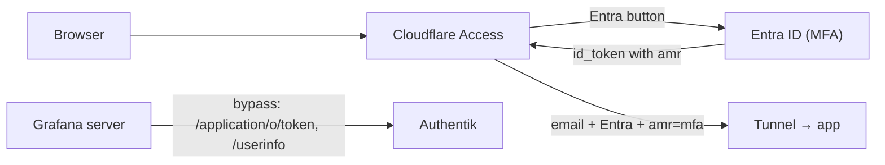

# Cloudflare Access: Entra ID Login with Enforced MFA

Every homelab hostname published through the Cloudflare Tunnel sits behind a Cloudflare Zero Trust Access application, defined in `terraform/cloudflare/` (`local.access_apps` in `locals.tf`, resources in `main.tf` §4).

## Policy model

Each app allows exactly one login method, Microsoft Entra ID. Each app's policy needs all three of these rules to match:

| Rule | Selector | Purpose |
| :--- | :--- | :--- |
| `include` | `email = [var.destination_email]` | Only the homelab admin identity |
| `require` | `login_method = [Entra ID IdP]` | The identity must come from Entra ID |
| `require` | `auth_method = "mfa"` | Entra must report MFA in the token's `amr` claim (RFC 8176) |

On the application, `allowed_idps = [Entra ID IdP]` hides every other account login method. `auto_redirect_to_identity` is `false`, so Access first shows its own login page with a single Microsoft Entra button. Set it to `true` to skip that page and go straight to Microsoft.



> [!IMPORTANT]
> An empty `allowed_idps` does not mean "none". It means "every login method enabled on the account", and that includes the email one-time PIN. Before 2026-10-19, the policies matched only the email address, so anyone who could read that inbox could get in with a PIN and never needed MFA. Keep `allowed_idps` set.

### Why `require` and not only `allowed_idps`

`allowed_idps` controls which buttons the login page shows. The `require` rules are what the policy actually enforces. `login_method` rejects a session minted by any other IdP. `auth_method = "mfa"` fails closed: if Entra accepts a sign-in without MFA, for example a password-only sign-in, Access still denies it. Under Entra Security Defaults, MFA is required "when necessary", not on every sign-in, so this check is what guarantees MFA for every Access session.

## Back-channel bypass (unchanged)

`auth.bar2sek.com` itself is an Access app. Two path-scoped apps with a `bypass` policy (`local.authentik_backchannel_paths`) keep Authentik's OIDC token and userinfo endpoints reachable for Grafana's server, which cannot carry an Access cookie. They are not anonymous: the token endpoint needs the OAuth client secret, and userinfo needs a bearer token. The IdP restriction does not apply to them, because a bypass skips identity entirely.

## Managed outside Terraform

The Entra ID login method (the Access IdP, ID in `local.access_idp_entra_id`) and its Entra app registration were created by hand. The CI API token gets `1010 auth.forbidden` when it tries to manage account-level IdPs, and it does not list them either. MFA itself is enforced by the Entra tenant (Security Defaults).

## Verification

Run these from outside the LAN. Split-horizon DNS sends LAN clients straight to the ingress, so a LAN probe skips Access. From a workstation on the LAN, resolve through the public edge:

```bash
IP=$(curl -s -H 'accept: application/dns-json' "https://cloudflare-dns.com/dns-query?name=grafana.bar2sek.com&type=A" | jq -r '.Answer[-1].data')
curl -s -o /dev/null --resolve grafana.bar2sek.com:443:$IP -w '%{http_code} %{redirect_url}\n' https://grafana.bar2sek.com/
```

| Check | Expected |
| :--- | :--- |
| Each protected host, unauthenticated | `302` to `<team>.cloudflareaccess.com/cdn-cgi/access/login/<host>` |
| Login page | One Microsoft Entra button, linking to `login.microsoftonline.com`. No "Send login code" option. |
| `POST auth.bar2sek.com/application/o/token/` with no client credentials | `400 invalid_client`, a JSON error from Authentik |
| `GET auth.bar2sek.com/application/o/userinfo/` with no token | `401`, with `x-authentik-id` and `www-authenticate: invalid_token` (from Authentik, not Access) |
| Browser login (private window, off-LAN) | Entra button, Microsoft sign-in with an MFA prompt, then the app. Grafana SSO through Authentik still completes. |

All checks passed on 2026-10-19 after the PR 8 apply, which used `auto_redirect_to_identity = true`. The login page was later switched to the button.

## Troubleshooting

- **"You don't have access" after a successful Microsoft login.** The token most likely had no `mfa` in `amr` (Entra skipped MFA), or the email didn't match. After a successful login, `https://<host>/cdn-cgi/access/get-identity` shows the `amr` and `idp` values Access recorded.
- **Locked out from outside the LAN.** LAN and Tailscale clients reach the services directly through split-horizon DNS. Revert the policy change through a PR, or temporarily edit the policy in the Zero Trust dashboard; the next apply will overwrite that edit.
- **Entra IdP recreated.** The IdP gets a new ID. Update `local.access_idp_entra_id`, or every app rejects logins.
- **Every plan shows the policies "changing", with `auth_method` moving between `require` blocks.** The API returns all require rules as one block. Declare them in a single `require` block, as `main.tf` does. Two separate blocks produce this diff forever, even though the live rules are correct.
- **The VS Code Terraform extension flags `require`/`allowed_idps`.** The language server uses the v5 provider schema. This root pins v4 (`~> 4.0`), and `terraform validate` is the source of truth.
